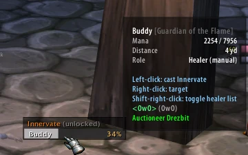

# InnervateBuddy

A small, minimal Druid addon for **Turtle WoW / 1.12 clients** that shows your group's mana users sorted by who is lowest on mana — so you always know who should get your Innervate.

- Lists **healers** by default, with an option to include DPS mana classes
- Shows the **5 lowest** by default (configurable 1–40)
- **Fades out** players who are out of Innervate range (30 yd)
- **Click to Innervate**, right-click to target
- Shows your **Innervate cooldown** in the header
- **Auto-detects healers by inspecting talents** (Turtle WoW allows inspecting at any range), or use a **manual healer list**, or both
- Slash commands and an options window

## Installation

1. Download the latest release (or **Code → Download ZIP**).
2. Extract it into `World of Warcraft/Interface/AddOns/`.
3. Make sure the folder is named exactly **`InnervateBuddy`** (GitHub ZIPs extract as `InnervateBuddy-main` — rename it).
4. Restart the game or `/reload`.

The result should be `Interface/AddOns/InnervateBuddy/InnervateBuddy.toc`.

## Usage

The frame appears when you're in a party or raid. Type `/ib unlock` to drag it somewhere, then `/ib lock`. Use `/ib test` to preview it with fake data while solo.

| Mouse | Action |
|---|---|
| Left-click | Cast Innervate on that player |
| Right-click | Target that player |
| Shift + Right-click | Add / remove that player from your manual healer list |

Each row shows the player's name in a class-coloured mana bar with their mana %. The % turns orange below 40% and red below 20%. Druids in cat/bear form show their last known mana as `~NN%`, since 1.12 can't read mana while shapeshifted.

## Slash commands

`/ib` or `/innervatebuddy`

| Command | Description |
|---|---|
| `/ib` | Open the options window |
| `/ib lock` / `/ib unlock` | Lock or unlock the frame |
| `/ib dps` | Toggle showing DPS mana classes |
| `/ib rows <n>` | Number of players shown (1–40) |
| `/ib mode auto\|manual\|both` | Healer detection mode |
| `/ib add [name]` | Add a healer to the manual list (no name = your target) |
| `/ib remove [name]` | Remove a healer from the manual list |
| `/ib list` / `/ib clear` | Show / clear the manual list |
| `/ib talents [on\|off]` | Detect healers by inspecting talents (default **on**) |
| `/ib combatlog [on\|off]` | Detect healers from the combat log (default **off**) |
| `/ib specs` | Show the inspected talent specs in your group |
| `/ib rescan` | Forget detected roles and re-inspect everyone |
| `/ib test` | Toggle preview mode with fake data |
| `/ib toggle` | Enable / disable the frame |
| `/ib reset` | Reset the frame position |
| `/ib help` | List commands |

## How healers are detected

The detection mode decides which sources are used:

- **Auto + Manual** (default) — your manual list, plus automatic detection
- **Auto only** — automatic detection only
- **Manual only** — only the players you've added

Automatic detection, in order:

1. **Talents (default).** Healing-class group members are inspected one at a time (every 2 s, paused in combat and while your own Inspect window is open). A player counts as a healer if they have at least as many points in healing trees as in their largest other tree:
   - Druid: Restoration · Priest: Discipline + Holy · Shaman: Restoration · Paladin: Holy

   Specs are saved between sessions, refreshed every 30 minutes, and forgotten after 14 days. Your own spec is read directly from your talents.
2. **Combat log (optional, off by default).** Counts healing spells vs. DPS spells (Shadowform, Moonkin, Starfire, Stormstrike, etc.) cast by group members. Uses SuperWoW's cast events too, if installed.
3. **Assumptions.** Priests are treated as healers until detected as Shadow. Enable *Assume hybrids heal* to do the same for druids, shamans and paladins.

## Options

Open with `/ib`.

- Lock frame, show DPS mana classes, include yourself, hide when solo, only show in combat, show header/cooldown, left-click casts Innervate, assume hybrids heal
- Sliders: players shown, mana threshold (only list players below X%), out-of-range alpha, width, scale
- Healer detection mode, talent inspect and combat log toggles, reset detection, test mode
- Manual healer list editor and a live list of detected healers in your group with the reason for each

## Compatibility

- Built for the **1.12 client** (Interface `11200`), targeting **Turtle WoW** and 1.18-based servers.
- Talent-inspect detection needs a server/client that supports inspecting talents (Turtle WoW does). On a plain 1.12 client, use the manual list or turn on combat log detection.
- Optional enhancements:
  - **[SuperWoW](https://github.com/balakethelock/SuperWoW)** — casts Innervate on the player without changing your target, and adds cast events to combat log detection.
  - **UnitXP_SP3** — exact distance for the range fade. Without it, the ~28 yd interact-distance check is used.
- Spell and talent-tree names are matched in **English**; other client languages aren't supported yet.

## License

[MIT](LICENSE)
